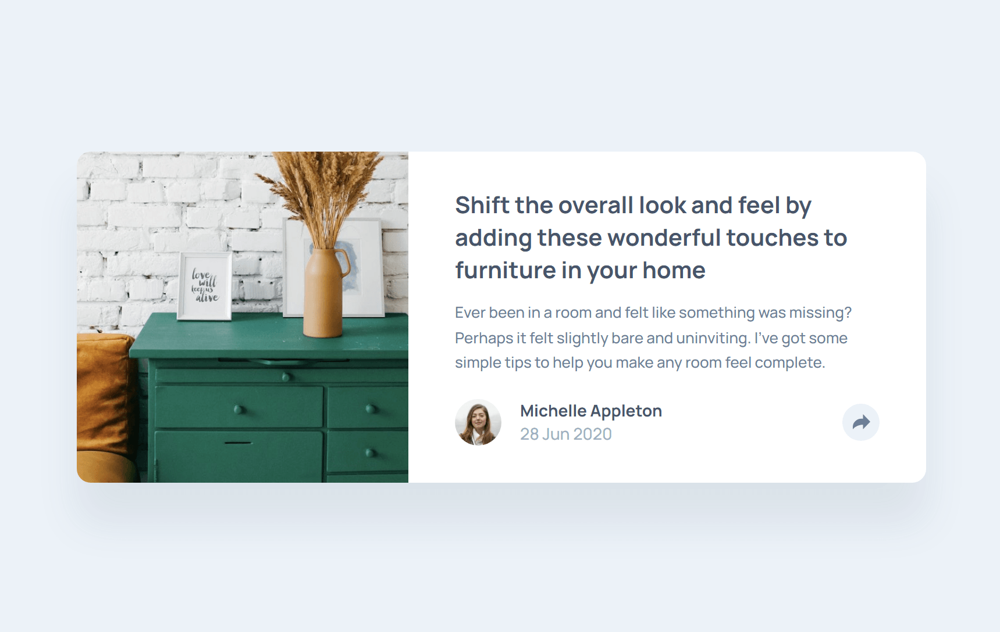
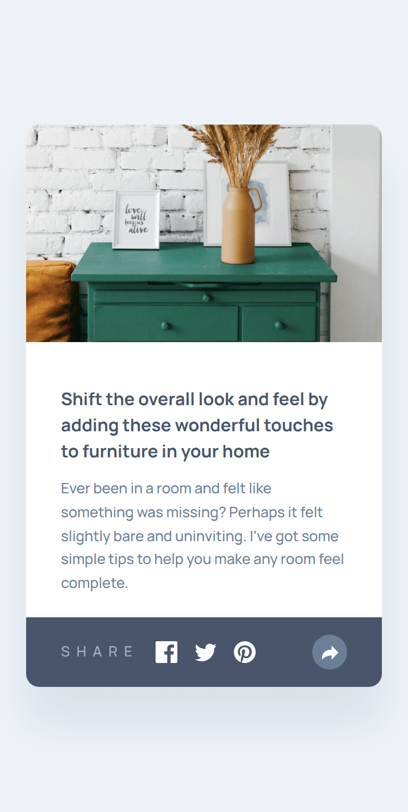

# Frontend Mentor - Article preview component solution

This is a solution to the [Article preview component challenge on Frontend Mentor](https://www.frontendmentor.io/challenges/article-preview-component-dYBN_pYFT).

## Table of contents

- [Overview](#overview)
  - [The challenge](#the-challenge)
  - [Screenshot](#screenshot)
  - [Links](#links)
- [My process](#my-process)
  - [Built with](#built-with)
  - [What I learned](#what-i-learned)
  - [Continued development](#continued-development)
  - [Useful resources](#useful-resources)
- [Author](#author)
- [Acknowledgments](#acknowledgments)

## Overview

### The challenge

Users should be able to:

- View the optimal layout for the component depending on their device's screen size
- See the social media share links when they click the share icon
- Experience smooth interactive UI states built with React and TypeScript

### Screenshot

|                                    Desktop Design                                     |                             Mobile Design With Share Links                              |
| :-----------------------------------------------------------------------------------: | :-------------------------------------------------------------------------------------: |
|  |  |

### Links

- [Solution URL Here](https://github.com/mustafa-abu-eisha/article-preview-component-ts)
- [Live Site URL Here](https://article-preview-component-ts-live.pages.dev/)

## My process

### Built with

- Semantic HTML5 markup
- Mobile-first workflow
- [React](https://react.dev/) - JS/TS library for building user interfaces
- [TypeScript](https://www.typescriptlang.org/) - For type safety and better developer experience
- [Tailwind CSS](https://tailwindcss.com/) - For rapid utility-first styling
- Flexbox & CSS Grid

### What I learned

Working on this project helped reinforce how to build responsive popovers and toggle states cleanly using React and TypeScript combined with Tailwind CSS.

Here is a snippet showing how state management handles the share tooltip toggle in TypeScript:

```tsx
import { useState, type JSX } from "react";

export default function App(): JSX.Element {
  const [isShareOpen, setIsShareOpen] = useState<boolean>(false);

  const handleToggleShareBtn = (): void => {
    setIsShareOpen((prev: boolean): boolean => !prev);
  };

  return (
    <button
      type="button"
      onClick={handleToggleShareBtn}
      className={`relative flex-center size-8 rounded-full ${isShareOpen ? "bg-dark-grayish text-white" : "bg-light-grayish text-dark-grayish"} cursor-pointer hover:bg-dark-grayish hover:text-white focus-visible:bg-dark-grayish focus-visible:text-white focus-visible:outline-0 transition duration-200`}
      aria-label="Share Article"
    >
      {/* Share Icon SVG */}
    </button>
  );
}
```

### Continued development

In future projects, I plan to:

- Deepen my knowledge of advanced Tailwind CSS animations and micro-interactions.
- Explore accessibility features (a11y) for dropdowns and popups to ensure full keyboard navigation support.
- Improve component reusability and modular structure in React applications.

### Useful resources

- [React Documentation](https://react.dev) - The updated React documentation helped me structure conditional rendering cleanly.
- [Tailwind CSS Docs](https://tailwindcss.com/docs) - Excellent resource for quick reference on utility classes and responsive breakpoints.
- [TypeScript Handbook](https://www.typescriptlang.org/docs/handbook/intro.html) - Helpful reference for typing event handlers and React component props.

## Author

- [Frontend Mentor Profile](https://www.frontendmentor.io/profile/mustafa-abu-eisha)
- [GitHub Profile](https://github.com/mustafa-abu-eisha)
- [LinkedIn Profile](https://www.linkedin.com/in/mustafaabueisha)

## Acknowledgments

Thanks to Frontend Mentor for providing realistic design challenges that help improve frontend development skills through hands-on practice.
